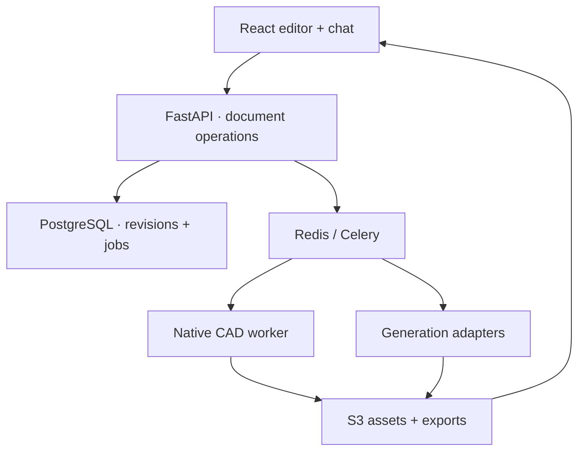

# Architecture and decisions

## What is the product?

A browser construction workshop for physical objects. The editor should feel immediate and enjoyable while retaining engineering dimensions. User Bartek is a developer, works in short sessions and wants to design a voice intermediary robot connected to AI agents on a VPS. He owns a Bambu X2D with AMS. Later workflows include image-generated figurines (e.g. a Quake-inspired statue), toys and enclosures around imported components.

## System boundaries

The browser renders immediate procedural approximations while dragging/editing. An explicit CAD rebuild returns a triangulated native B-rep plus validity/volume. Exact-preview signatures depend on resolved parameters; changing geometry invalidates the prior preview. CAD does not run on the UI thread.

## Durable project

`Project` is a versioned document, not a triangle soup. It stores component instances, generator/template IDs, parameters, uniform transforms, roles, colors, asset IDs and dimension dependencies. Catalog v0.1 definitions are fixed in a shared JSON file. Persisting immutable definition versions and user-created templates is the next evolution, not a replacement of the document boundary.

The application currently stores revision snapshots; it does not implement event sourcing. Operation history is local undo/redo, while server snapshots are independent persisted versions. No collaboration algorithm is claimed.

Coordinates: millimeters, Z up, bottom of each local part at Z=0. Transform order: uniform scale, rotation around X then Y then Z, translation. Three uses ZYX Euler order to match this convention. `head` is open at +Y (back); display opening faces -Y.

## Why these technologies

| Layer | Choice | Reason |
|---|---|---|
| UI | React + TypeScript + Vite | Editor-first app, minimal dependency on hosting framework |
| 3D | Three.js + React Three Fiber + Drei | Selection, controls, rendering; not a CAD kernel |
| Editor state | Zustand | Command commits, undo and UI state |
| Server state | TanStack Query | Capability/status queries; explicit job polling |
| API/validation | FastAPI + Pydantic | Typed document boundary and schema publication |
| CAD | Native CadQuery 2.7 / Open CASCADE | Accurate B-rep generation, STEP/STL and triangulation |
| Documents | PostgreSQL + SQLAlchemy + Alembic | Durable revisions and controlled schema migrations |
| Files | S3 interface; MinIO for local Compose | Transferable original/generated assets |
| Jobs | Celery + Redis | Keep long/native tasks outside interactive API processing |
| Front door | Caddy | Static frontend and same-origin API |

No claim of zero future migrations. Stable document/provider boundaries reduce their scope. Library and model versions are pinned in lockfiles. Image tags should be promoted to reviewed image digests before a shared production deployment.

## Providers

OpenAI produces a limited edit plan via structured outputs. A narrow hand-written adapter is sufficient at this stage; the earlier candidate PydanticAI is not installed because there is no multi-step tool loop yet. If added later, keep it behind the same planner boundary. Provider output is still validated as domain operations before mutation.

Meshy implements image-to-GLB behind a `MeshProvider` protocol. Credentials, task IDs, retries, download URLs and provider-specific payloads remain outside project geometry. A future TRELLIS worker can implement this interface. It will not automatically replace Meshy's repair, segmentation or multi-color-print services.

Generated image concepts, CAD mechanics and generated organic meshes are distinct pipelines. Do not infer exact dimensions or wall thickness from texture/PBR appearance. OpenAI image generation is a planned adapter, not a working capability in v0.1.

## Files and export

STL has geometry without parameters/colors. STEP contains exact resulting solids but does not promise native feature-history interchange. Generic 3MF contains separate meshes, units, base materials and build items; vertices are welded across face boundaries. It has no Bambu printer profile, AMS mapping, supports or G-code.

Imported STL/GLB objects are renderable scene instances with preserved originals. v0.1 exports parametric objects; imported meshes are downloaded in their source format until mesh repair/export joins the pipeline. Do not silently drop selected imported geometry from exports.

## Current operational boundaries

Compose serves one authenticated owner. Public landing/login pages are separate from the protected editor. Argon2id credentials and revocable opaque sessions live in PostgreSQL; CSRF and persistent login throttling guard mutations/login. Migration 0002 preserves existing records under the singleton owner. See `AUTHENTICATION.md` for setup and the local-draft boundary. Jobs persist status in PostgreSQL and use a compare-and-swap claim so a duplicate message cannot start the same paid generation twice. A worker crash can leave a job marked `running`; the next implementation should add heartbeats, reconciliations and explicit resume using a stored provider task ID. Never solve this by automatically replaying a charged POST.

For initial development, one worker processes CAD and generation sequentially. Separate queues/workers using the same job contract when long Meshy requests interfere with CAD interaction. Native preview tasks currently return mesh JSON in the job result; large results should become assets with content hashes.

SQLite/disk/inline is an explicit development alternative. It is not a seamless data migration tool. The API contract and application operations are the same; move data deliberately if switching a used workspace between environments.
